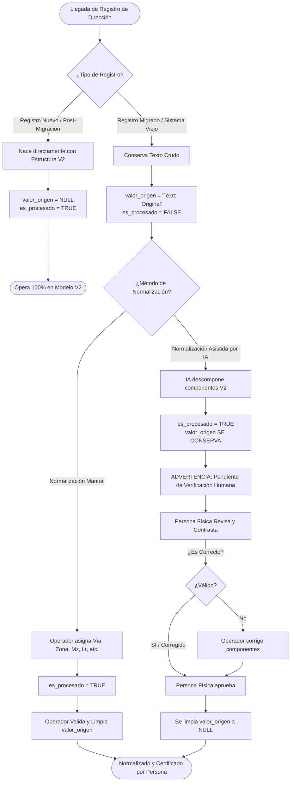

# Guía de Gestión y Transición de Direcciones para Sistemas Legados

## 1. Introducción y Propósito

Este documento establece la arquitectura funcional, el ciclo de vida y los lineamientos de auditoría para la gestión de direcciones en **sistemas legados (sistemas viejos)** que migran hacia el modelo relacional normalizado V2 de la Municipalidad Provincial de Chiclayo (MPCH).

En sistemas preexistentes, las direcciones se almacenaban típicamente como cadenas de texto libre no estructuradas, heterogéneas y con abreviaciones no estandarizadas. La transición hacia el modelo normalizado requiere un proceso seguro de **convivencia temporal**, donde se mantenga la trazabilidad del dato original hasta que sea certificado por una persona física.

---

## 2. Parámetros Clave del Modelo de Convivencia

En la tabla [`tb_direccion`](file:///home/victorchung/IdeaProjects/ETL_MIGRACION_MPCH/scripts_data_base/06_crear_estructura_v2_normalizada.sql#L90-L135), el control de la transición se rige por los siguientes atributos:

| Campo | Tipo de Dato | Propósito en el Ciclo de Vida |
| :--- | :--- | :--- |
| `valor_origen` | `VARCHAR` / `TEXT` | Cadena original no estructurada migrada del sistema viejo. Sirve como referencia inmutable durante la transición. |
| `es_procesado` | `BOOLEAN` | Indica si el registro ya cuenta con estructura normalizada (`tb_via`, `tb_zona`, `num_via`, Mz, Lt, etc.). |
| `resa_created_at` | `TIMESTAMP` | Marca de tiempo de inserción original del registro. |
| `resa_updated_at` | `TIMESTAMP` | Marca de tiempo de última modificación o normalización. |

---

## 3. Matriz de Tratamiento según Origen del Registro

El sistema clasifica las direcciones en dos grandes vertientes operativas:



---

## 4. Detalle de los Flujos de Operación

### 4.1. Registros Nuevos (Creados Post-Migración)
- **Definición**: Direcciones ingresadas por usuarios o nuevos expedientes a través del nuevo sistema.
- **Comportamiento**:
  - Se capturan directamente mediante los catálogos y componentes relacionales V2 (selección de tipo de vía, vía canónica, tipo de zona, zona, numeración municipal, manzana, lote, etc.).
  - **El parámetro `valor_origen` NO se utiliza** (debe quedar como `NULL`).
  - `es_procesado = TRUE` desde su nacimiento.
  - No requieren pasar por ninguna etapa de auditoría de texto libre.

---

### 4.2. Registros Preexistentes (Migrados de Sistemas Viejos)

#### Fase 1: Estado Inicial Migrado
- Al migrar la base de datos previa, la dirección textual se almacena íntegramente en `valor_origen`.
- `es_procesado = FALSE`.
- La interfaz de usuario debe mostrar `valor_origen` como dato de consulta y referencia principal, alertando que la dirección carece de normalización formal.

#### Fase 2A: Normalización Manual por un Operador Humano
- **Interacción**:
  1. El operador visualiza en pantalla el `valor_origen` como referencia.
  2. Selecciona o ingresa los componentes normalizados correspondientes (`via_id`, `num_via`, `zona_id`, etc.).
  3. El sistema actualiza el registro asignando los identificadores relacionales y marca `es_procesado = TRUE`.
  4. Al haber sido ingresado y verificado directamente por una persona física, el sistema **permite limpiar `valor_origen`** (estableciéndolo en `NULL`), dando por convalidada la dirección.

#### Fase 2B: Normalización Asistida por Inteligencia Artificial (IA)
- **Interacción**:
  1. El modelo de IA procesa la cadena de texto de `valor_origen` e infiere los componentes canónicos (`id_via`, `nom_via`, `id_zona`, `num_via`, etc.).
  2. El registro se actualiza con la estructura extraída y se establece `es_procesado = TRUE`.
  3. **ADVERTENCIA OBLIGATORIA DEL SISTEMA**:
     > ⚠️ **Advertencia de Auditoría**: La dirección ha sido estructurada por Inteligencia Artificial. Dado que los modelos de lenguaje pueden generar interpretaciones erróneas o alucinaciones en casos atípicos, es **obligatorio que un operador humano verifique la coherencia del nuevo formato antes de darla por definitiva**.
  4. **Regla de Conservación Estricta**:
     - Durante la intervención de la IA, **el campo `valor_origen` SE CONSERVA OBLIGATORIAMENTE**.
     - Bajo ninguna circunstancia la IA debe limpiar o sobreescribir el campo `valor_origen`.
     - La interfaz debe presentar una vista comparativa:
       - *Original (Referencia)*: Valor de `valor_origen`.
       - *Propuesta IA (Estructura V2)*: Vía, Zona, Mz, Lt, Número extraídos.
       - *Estado*: `Pendiente de Verificación Humana`.

#### Fase 3: Validación y Certificación Humana
- **Protocolo de Cierre**:
  1. Una persona física ingresa a la bandeja de verificación.
  2. Compara el `valor_origen` con la propuesta estructurada por la IA.
  3. Si la propuesta es correcta (o tras realizar las correcciones manuales pertinentes), el operador presiona la acción **"Verificar y Certificar"**.
  4. Esta acción ejecuta la limpieza formal de `valor_origen` (`valor_origen = NULL`), certificando que el registro ya fue auditado por un funcionario.

---

## 5. Hito de Cierre de Transición: "Zero-Valor-Origen"

El proceso de migración y transición de un sistema legado se considerará **100% concluido** cuando en la base de datos se cumpla la siguiente condición:

```sql
-- Métrica de control de transición
SELECT COUNT(*) AS registros_pendientes_auditoria
FROM tb_direccion
WHERE valor_origen IS NOT NULL;
```

- **Cuando el resultado sea 0:**
  1. Todos los registros históricos han sido estructurados y convalidados por personas físicas.
  2. No existen ambigüedades pendientes de auditoría.
  3. El sistema puede retirar las vistas comparativas de legado y operar de forma unificada exclusivamente bajo la nueva arquitectura relacional V2.

---

## 6. Resumen de Reglas de Negocio para el Desarrollador de UI/Backend

1. **Inserción de Registros Nuevos**:
   - `valor_origen = NULL`.
   - `es_procesado = TRUE`.

2. **Procesamiento por IA**:
   - Asigna llaves foráneas y componentes V2.
   - `es_procesado = TRUE`.
   - **Mantiene intacto `valor_origen`**.
   - Muestra alerta visible de verificación obligatoria en la UI.

3. **Verificación Manual (Humana)**:
   - Permite al operador editar componentes V2.
   - Al pulsar "Verificar / Aprobar": limpia el campo `valor_origen` a `NULL`.
   - Actualiza `resa_updated_at = CURRENT_TIMESTAMP`.

4. **Visualización en la Interfaz**:
   - Si `valor_origen IS NOT NULL` y `es_procesado = TRUE`: mostrar en amarillo/ámbar con etiqueta `"Sugerencia IA - Requiere Confirmación"`.
   - Si `valor_origen IS NOT NULL` y `es_procesado = FALSE`: mostrar en rojo con etiqueta `"Pendiente de Normalizar"`.
   - Si `valor_origen IS NULL` y `es_procesado = TRUE`: mostrar en verde con etiqueta `"Dirección Canónica Válida"`.
